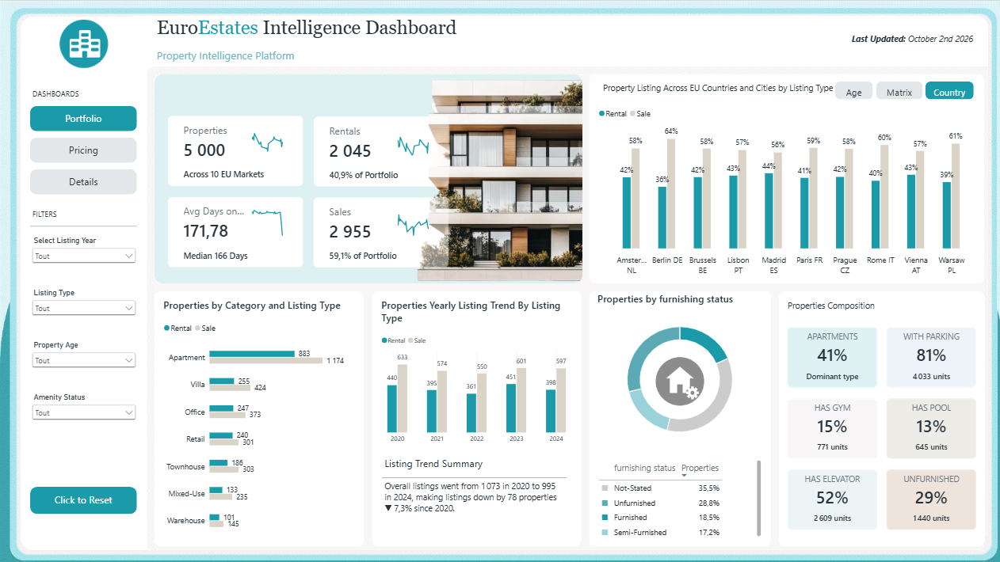
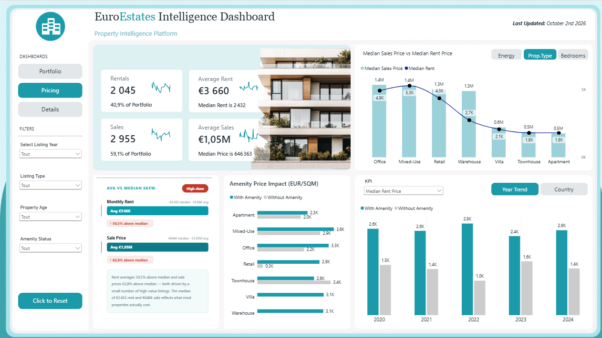
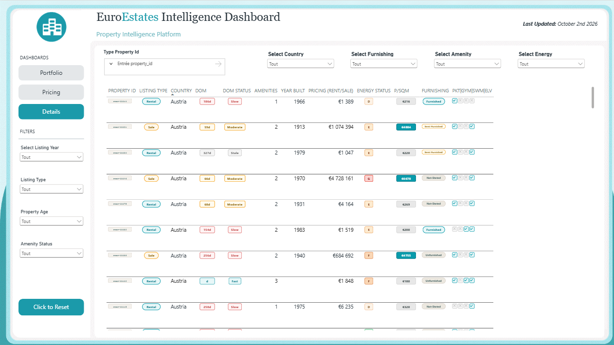

# EuroEstates Intelligence Dashboard

Un tableau de bord immobilier en 3 pages sur 5 000 annonces réparties dans 10 marchés européens : portefeuille, prix et fiche détaillée de chaque bien.

## Ce que contient le dashboard

| Page | Contenu |
|---|---|
| **Portfolio** | indicateurs (biens, locations, ventes, jours sur le marché) avec mini-courbes, répartition par pays, catégorie, année et statut d'ameublement, composition du parc (parking, salle de sport, piscine, ascenseur) |
| **Pricing** | loyer et prix de vente moyens et médians, carte « moyenne contre médiane » avec écart, impact des équipements sur le prix au m², tendance par année ou par pays, sélecteur d'indicateur |
| **Details** | tableau de chaque bien avec pastilles de couleur (délai de vente, classe énergétique, ameublement, équipements), recherche par identifiant et filtres |

## Techniques

- **Modèle en étoile** : table de faits `EU Real Estate`, dimensions `Dim Calendar`, `Dim Location`, `Dim Property Type`, et table de paramètres `KPI Selector`. **57 mesures DAX** (médianes, parts, comparaisons, indicateurs conditionnels).
- **Pastilles et badges en SVG** : des colonnes et mesures calculées renvoient une image SVG (URI de données) affichée dans le tableau, pour les couleurs conditionnelles.
- **Cartes « écart à la médiane »** : la carte `Avg vs Median Skew` est un SVG généré par mesure.
- **Mini-courbes** sur les cartes d'indicateurs.
- **Bascules de vue** (Age / Matrix / Country, Energy / Prop.Type / Bedrooms, Year Trend / Country) : **signets** qui masquent et affichent des graphiques.
- **Paramètre de champ** pour choisir l'indicateur affiché.
- **Navigation** par boutons de page, filtres synchronisés entre les pages et bouton de réinitialisation.
- Format **PBIP / PBIR / TMDL** : tout le projet est du texte, versionnable avec git.

## Sources

Ce dépôt est une **vitrine** : il présente le projet et ses résultats. Les sources (projet Power BI, requêtes, scripts, notebook, données) ne sont pas publiées. Pour en discuter, me contacter via mon profil GitHub.
